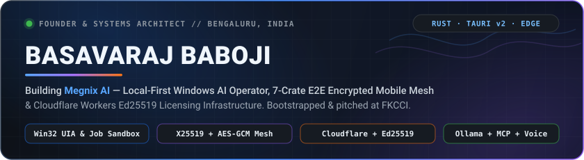
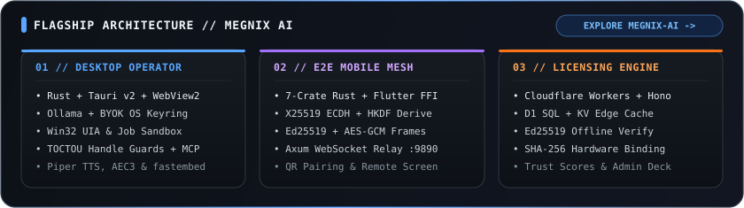

<div align="center">

<a href="https://github.com/basavarajbaboji/megnix-ai">
  
</a>

<br /><br />

<a href="https://github.com/basavarajbaboji/megnix-ai">
  
</a>

<br /><br />

[](https://github.com/basavarajbaboji/megnix-ai)
[](https://github.com/basavarajbaboji/megnix-ai)
[](https://github.com/basavarajbaboji?tab=repositories)

</div>

---

## `whoami`

```yaml
role:       Founder & Systems Engineer (Solo, Self-Funded)
focus:      Local-First AI Agents · OS-Level Sandboxing · Applied Cryptography · Edge Backends
milestone:  Pitched Megnix AI at FKCCI (Federation of Karnataka Chambers of Commerce & Industry), Bengaluru
philosophy: "AI should move beyond text boxes — execute safely inside real shells, devices, and networks."
```

---

## ⚡ Flagship Project — [Megnix AI](https://github.com/basavarajbaboji/megnix-ai)

<div align="center">

<a href="https://github.com/basavarajbaboji/megnix-ai">
  
</a>

</div>

<details>
<summary><b>Inspect What Lives Inside the Codebase →</b></summary>

- **OS-Native Desktop Operator (`megnix_ai`):** Built in **Rust + Tauri v2 + SQLite** with local **Ollama** inference, OS Credential Manager (`keyring`) BYOK routing, **Win32 UI Automation (`uia.rs`)** with allowlists/blocklists, **Win32 Job Object** sandboxing (`win32_sandbox.rs`), TOCTOU-safe handle operations (`handle_ops.rs`), MCP server hosting, **Piper** TTS, **AEC3** voice cancellation, and local **ONNX / `fastembed`** retrieval.
- **Encrypted Desktop ↔ Mobile Mesh (`megnix_connect` + `megnix_mobile`):** A **7-crate Rust workspace** (`X25519`, `Ed25519`, `HKDF`, `AES-GCM`, chunked transfers, Axum WebSocket relay on `:9890`) bridged over C-ABI FFI (`megnix_mobile_ffi`) to a **Flutter** mobile client for QR pairing and remote control.
- **Ed25519 Licensing Infrastructure (`license-server`):** Standalone **Cloudflare Workers + D1 + KV + Hono** API issuing hardware-bound offline-verifiable tokens (`@noble/curves` ↔ `ed25519-dalek`), complete with trust scoring, quarantine states, soft/hard bans, and an Admin Web Deck.

</details>

---

## 🧰 Selected Engineering Work

<table>
  <tr>
    <td width="50%" valign="top">
      <h3><a href="https://github.com/basavarajbaboji/megnix-ai">⚡ megnix-ai</a></h3>
      <p><b>Rust · Tauri v2 · TypeScript · Flutter · Cloudflare Workers</b></p>
      <p>Local-first Windows AI operator, 7-crate E2E encrypted mobile mesh, and Ed25519 hardware-bound licensing backend — source-available for testing and upstream contributions.</p>
    </td>
    <td width="50%" valign="top">
      <h3><a href="https://github.com/basavarajbaboji/face-recognisation-system-for-attendence">🏛️ smart-campus-face-attendance</a></h3>
      <p><b>Python · FastAPI · ONNX (ArcFace/YuNet) · React 19 · SQLite WAL</b></p>
      <p>Multi-target crowd face recognition and attendance surveillance command center using ByteTrack Kalman + IoU tracking and temporal confirmation state machines.</p>
    </td>
  </tr>
  <tr>
    <td width="50%" valign="top">
      <h3><a href="https://github.com/basavarajbaboji/universal-video-downloader">🌐 universal-video-downloader</a></h3>
      <p><b>TypeScript · Node.js · Docker</b></p>
      <p>Full-stack media extraction pipeline supporting 1000+ platforms with quality selection, MP3 audio extraction, responsive UI, and containerized deployment.</p>
    </td>
    <td width="50%" valign="top">
      <h3><a href="https://github.com/basavarajbaboji/kaggriculture">🌾 kaggriculture</a></h3>
      <p><b>Python · Multi-Agent Strategy · Simulation Replay</b></p>
      <p>Autonomous strategy and dynamic market ROI analyzer built for the Kaggle Kaggriculture simulation environment with custom replay visualization.</p>
    </td>
  </tr>
</table>

---

## 🛠️ Core Stack

<div align="center">


<br /><br />

| Layer | Technologies Used in Production Codebases |
| :--- | :--- |
| **Systems & Desktop** | Rust (`tokio`, `axum`, `ed25519-dalek`, `x25519-dalek`), Tauri v2, Win32 APIs (UIA, Job Objects), C-ABI FFI |
| **AI, Voice & Vision** | Ollama, MCP (`stdio`/HTTP), `fastembed`, ONNX Runtime (DirectML, ArcFace, YuNet), Piper TTS, AEC3, Whisper |
| **Web, Mobile & Edge** | TypeScript, React 19, Vite, Flutter / Dart, Hono, Cloudflare Workers, D1, KV, SQLite (WAL) |

</div>

---

## 📈 Contribution Pulse

<div align="center">


<br />


<br />

<picture>
  <source media="(prefers-color-scheme: dark)" srcset="https://raw.githubusercontent.com/basavarajbaboji/basavarajbaboji/output/github-contribution-grid-snake-dark.svg" />
  <source media="(prefers-color-scheme: light)" srcset="https://raw.githubusercontent.com/basavarajbaboji/basavarajbaboji/output/github-contribution-grid-snake.svg" />
  
</picture>

</div>

---

<div align="center">

### `Build → Measure → Harden → Ship.`

[](https://github.com/basavarajbaboji/megnix-ai)
[](https://github.com/basavarajbaboji?tab=repositories)

</div>
